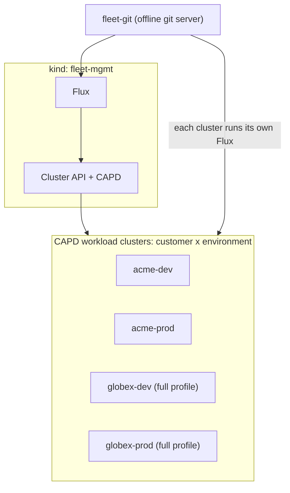

# Fleet-in-a-Repo

A GitOps fleet in one repository: a Cluster API management cluster creates one Kubernetes cluster per
customer and environment, Flux configures each of them from the same Git source, and versions move
dev -> test -> prod through reviewed pull requests. Everything runs locally in Docker, at no cost.

Status: the local flow (`make up`, `make smoke`, `make down`) has been run end to end. The GitHub
workflows in `.github/workflows/` are statically tested but have not yet been executed against a live
GitHub repository.

## Architecture



Details, Flux layering and the promotion diagram: [docs/architecture.md](docs/architecture.md).

## Quickstart

Repository: <https://github.com/astawiany/fleet-in-a-repo>

```bash
git clone https://github.com/astawiany/fleet-in-a-repo.git
cd fleet-in-a-repo
```

Prerequisites: Docker, `kind`, `clusterctl`, `flux`, `helm`, `kubectl`, `kubeconform`, `jq`, `yq`,
`git` and `curl` (checked by `scripts/preflight.sh`, together with Docker memory; it warns when the
installed `flux`, `kind` or `clusterctl` differs from its pin), plus `bats` for `make test` (dev-only,
not checked by preflight). Versions are pinned in `versions.env`.

```sh
FLEET_PROFILE=lite make up      # management cluster + workload clusters, Flux everywhere
FLEET_PROFILE=lite make smoke   # acceptance checks, one PASS/FAIL line each
FLEET_PROFILE=lite make down    # removes clusters, containers, kubeconfigs
```

Drop `FLEET_PROFILE=lite` for the full profile. `make up` is idempotent. Only committed changes are
synced to the clusters (the offline git server serves git HEAD), so commit before re-running.

Measured on 2026-11-03 on a 7.7 GiB Docker Desktop with the lite profile, from a clean state: `make up` 6m43s
(images already pulled), `make smoke` 1m05s with 12/12 checks PASS, `make down` 5s, leaving no kind clusters,
containers, `.work/` or fleet kubeconfig contexts. The full 2x2 profile has not been run: this machine does not meet its 12 GiB floor.
The author's observation from those runs (not a guarantee): only about 1 GiB of the VM was spare (container peak about 5.1 GiB, swap in use). The
preflight floor of 6 GiB for lite was never run on a 6 GiB VM; anything below 7.7 GiB is untested.
In an earlier run, before the lite trimming (API-server metrics scraping off), Prometheus on `acme-prod` was OOM-killed.

Advanced: `FLEET_FLUX_GITHUB=owner/repo` (with `GITHUB_TOKEN`) makes `make up` bootstrap the
management cluster's Flux from GitHub instead of the offline git server. It bootstraps only the
management cluster; workload clusters still sync from the offline git server.

### Profiles

| Profile | Clusters | Docker memory | Notes |
|---|---|---|---|
| `full` (default) | acme and globex x dev and prod = 4 | at least 12 GiB | |
| `lite` | acme x dev and prod = 2 | 6 GiB floor in preflight (untested; 7.7 GiB verified) | API-server metrics scraping disabled so Prometheus fits |

## Repository layout

| Path | Content |
|---|---|
| `capi/` | Cluster API: ClusterClass, CNI, one `Cluster` per customer x environment |
| `clusters/` | Flux entrypoint per cluster (`management/{full,lite}`, `<customer>-<env>`) |
| `infrastructure/` | Platform add-ons: cert-manager, Gateway API CRDs, NGINX Gateway Fabric, MetalLB, Prometheus + Grafana |
| `apps/demo/` | Demo app (web, api, worker): source, Helm chart, per-customer values, Flux delivery |
| `promotion/` | Version pins per environment |
| `kind/` | Management cluster config and offline git server |
| `scripts/` | `make` targets, smoke checks, promotion, CI helpers |
| `test/` | bats tests |
| `docs/` | Architecture and ADRs |
| `.github/` | Workflows, CODEOWNERS, setup notes |

## How promotion works

1. A chart version is released (`release.yml`, tag `chart-v*`). Bumping the dev pin
   `promotion/versions/dev.yaml` is a manual PR; `release.yml` does not do it. After merge, the
   `*-dev` clusters pick it up.
2. `promote.yml` opens a PR copying the pin to `test.yaml`, then another from `test` to `prod`
   (`scripts/promote.sh <from> <to>` does the copy). Each PR needs the `validate.yml` checks and
   review; the job that opens it runs in the `test` or `prod` GitHub Environment, which has
   required reviewers. PRs opened with `GITHUB_TOKEN` do not run `validate.yml`; see
   [.github/README.md](.github/README.md) for the workaround.
3. There are no `*-test` clusters in 1a, so the `test` pin is a staging gate that no cluster reads yet.
4. A pin sets the `HelmRelease` image tag (and the chart version, which Flux ignores for charts from
   a Git source), so image and chart move in lockstep.

Per-customer behaviour is Helm values (`apps/demo/values/<customer>-<env>.yaml`), including feature
flags such as `FEATURE_NEW_BANNER`: code ships dark and a one-line PR enables it for one customer.

## Observability

Each workload cluster runs Prometheus and Grafana. Dashboards: `Platform health` (Flux objects,
nodes, pods, capacity) and `Demo SLIs` (latency, errors). SLO burn-rate alerts:
`DemoErrorBudgetBurnFast` and `DemoErrorBudgetBurnSlow`. The SLIs count application requests only
(health probes and metric scrapes are not instrumented), so the `Demo SLIs` panels show "No data"
until something calls the app; `make smoke` sends 200 `GET /feature` requests per cluster.

Grafana is a ClusterIP Service with the chart's default admin credentials. That is acceptable only
for this local demo. Reach it with `kubectl port-forward` and never expose it through the gateway.
For anything real, supply the admin credentials from an existing Secret.

```sh
KUBECONFIG=.work/kubeconfigs/acme-dev.yaml kubectl -n monitoring port-forward svc/kube-prometheus-stack-grafana 3000:80
```

## Acceptance checks

`make smoke` prints one `PASS|FAIL <criterion> <cluster>` line per criterion and cluster: `flux`
plus the five below (`scripts/smoke.d/`). With the lite profile that is 2 clusters x 6 = 12 lines.

| Criterion | Asserts | Honest limits |
|---|---|---|
| flux | Every Flux Kustomization and HelmRelease is Ready; a FAIL names the object | |
| compliance | demo Deployments carry the required labels, and every pod template is selected by a NetworkPolicy | demo namespace only |
| performance | p95 of 200 `GET /feature` requests is under 200 ms and all return 200 | Measured through `kubectl port-forward`, so it is an upper bound of in-cluster latency |
| resilience | After deleting one api pod, the Deployment returns to its desired Ready replicas within 60 s | Pod loss only, not node loss |
| observability | All active Prometheus targets are up and Grafana serves both dashboards | |
| security | No privileged container in the demo namespace; a default-deny ingress NetworkPolicy selects every pod | Demo namespace only: kind's kube-proxy and kindnet are privileged by design |

## CI and governance

`validate.yml` (lint, validate, test, lite smoke on a throwaway kind cluster), `promote.yml`,
`release.yml`; branch protection and Environments via `scripts/protect-branch.sh`; CODEOWNERS.
Setup steps and the `GITHUB_TOKEN` limitation: [.github/README.md](.github/README.md).
`.github/CODEOWNERS` assigns every path to `@astawiany`; add teams or users there as needed.
Flux commit-status notifications are provided as opt-in manifests in
`infrastructure/base/flux-notifications/`.

## Known limitations

- Flux is pinned to 2.2.3, which serves the older `v2beta2` (HelmRelease) and `v1beta2`
  (HelmRepository/OCIRepository) APIs. Bumping it means moving those manifests to the current APIs
  and needs a real `make up`/`make smoke` run.
- On Linux, kind nodes need `fs.inotify.max_user_instances` of at least 512 (many distros default to
  128, and nodes then fail with "Too many open files"): `sudo sysctl fs.inotify.max_user_instances=512
  fs.inotify.max_user_watches=524288`. `preflight.sh` warns when it is lower.
- Only the CLI versions pinned in `versions.env` are tested; `preflight.sh` warns about others but
  does not stop.

## Cost

None locally: everything runs in Docker. There is no cloud account or paid service involved.

## Decisions (ADRs)

1. [Flux instead of Argo CD](docs/adr/0001-flux-vs-argocd.md)
2. [Monorepo with a directory per environment](docs/adr/0002-monorepo-env-dirs.md)
3. [Feature flags as Helm values](docs/adr/0003-feature-flags-as-helm-values.md)
4. [GitHub Actions vs GitLab CI](docs/adr/0004-github-actions-vs-gitlab-ci.md)
5. [CAPD as the local provider](docs/adr/0005-capd-as-local-provider.md)

## License

[MIT](LICENSE)
