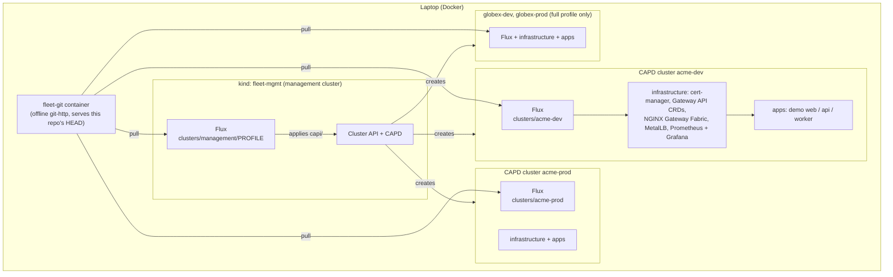
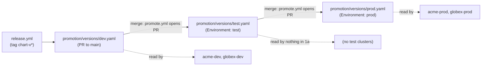

# Architecture

## Overview

A `kind` management cluster runs Cluster API (CAPD provider) and Flux. Flux applies `capi/`, which
declares one workload `Cluster` per customer x environment from a shared ClusterClass. Each workload
cluster then runs its own Flux, pointed at `clusters/<name>/`, which applies the shared platform
add-ons (`infrastructure/`) and then the demo app (`apps/demo/`). All clusters pull from the same Git
source: by default an offline git server container (`fleet-git`), so no GitHub account is needed.

`PROFILE` is `full` or `lite`. The `lite` profile keeps only the `acme` clusters.

## Flux layering in a workload cluster

1. `flux-system` (`clusters/<name>/flux-system/gotk-sync.yaml`): the `GitRepository` and the
   Kustomization that syncs `clusters/<name>/` itself.
2. `infrastructure` (`clusters/<name>/infrastructure.yaml`, path `infrastructure/overlays/<env>`):
   one Flux Kustomization per add-on in `infrastructure/base/components.yaml`, ordered with
   `dependsOn`, with `wait: true`. Variables (add-on versions, MetalLB pool) come from the
   `cluster-vars` ConfigMap via `postBuild.substituteFrom`; `dev` and `prod` overlays differ in
   Prometheus retention.
3. `apps` (`clusters/<name>/apps.yaml`, path `apps/demo/flux/<name>`): `dependsOn: infrastructure`.
   Builds a `HelmRelease` of `apps/demo/chart`, the per-cluster values ConfigMap
   (`apps/demo/values/<name>.yaml`) and the promotion pin.

## Promotion

Each pin holds `chart.version`. A Kustomize `replacement` copies it into the `HelmRelease`'s
`spec.values.image.tag` and `spec.chart.spec.version`. Because the chart comes from the Git
repository, Flux ignores the latter, so the image tag is what changes at runtime. See
[ADR 2](adr/0002-monorepo-env-dirs.md).

## Platform add-ons

| Add-on | Purpose | Notes |
|---|---|---|
| cert-manager | Certificates | Version from `versions.env` |
| Gateway API CRDs | `Gateway`, `HTTPRoute` | Fetched from the upstream tag `v$GATEWAY_API_VERSION` |
| NGINX Gateway Fabric | Gateway API implementation | 1a only; Istio takes over in 1c |
| MetalLB | `LoadBalancer` IPs (L2) | Pool derived from the kind Docker network |
| kube-prometheus-stack | Prometheus, Grafana, dashboards, SLO rules | Dashboards `Platform health`, `Demo SLIs`; `DemoErrorBudgetBurnFast` / `DemoErrorBudgetBurnSlow` alerts |

## Where things live

| Path | Content |
|---|---|
| `capi/` | Namespace, ClusterClass, kindnet ClusterResourceSet, one `Cluster` per customer x environment, `profiles/lite` |
| `clusters/` | Flux entrypoints: `management/{full,lite}`, one directory per workload cluster |
| `infrastructure/` | `base/` add-ons, `overlays/{dev,prod}`, opt-in `base/flux-notifications` |
| `apps/demo/` | `src` (Go service), `chart`, `values`, `flux` (per-cluster delivery) |
| `promotion/` | Pins per environment |
| `kind/` | Management cluster config, offline git server image |
| `scripts/` | `up`, `down`, `mgmt-up`, `sync-workloads`, `smoke` and `smoke.d/*`, `promote`, CI helpers |

Decisions are recorded in [docs/adr/](adr/0001-flux-vs-argocd.md).
